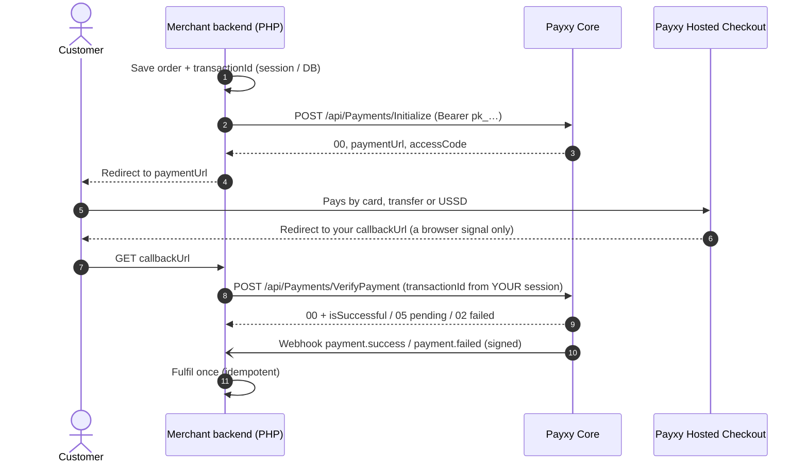

# Hosted Checkout

[← Back to README](../README.md)

Hosted Checkout is the supported way to collect payments with this SDK. **Card details, PINs and OTPs are entered on
Payxy's checkout page. They never pass through your PHP application.**

## End-to-end flow



The final confirmation **must** come from VerifyPayment or a signature-verified [webhook](webhooks.md). Parameters on
the browser redirect are never proof of payment.

## Option A: API only

See [payment initialization](payment-initialization.md) and [verification](payment-verification.md):

```php
$response = $payxy->payments()->initialize(new InitializePaymentRequest(
    email: 'customer@example.com',
    amount: Amount::fromString('75000.00'),
    transactionId: $transactionId,                       // already saved on the order
    currency: 'NGN',
    callbackUrl: 'https://merchant.example.com/payments/payxy/return',
));
header('Location: ' . $response->getPaymentUrl());   // always an absolute https:// checkout URL
exit;
```

`getPaymentUrl()` never returns a relative path. If Payxy's `paymentUrl` isn't an absolute `https://` URL (for example
a bare access code), the SDK uses the environment's hosted checkout instead (`https://checkout.payxy.ng/{accessCode}`
for test keys, `https://checkout.payxy.africa/{accessCode}` for live keys). `getRawPaymentUrl()` returns Payxy's original
value for logging.

On the callback route:

```php
// Wrong: $order->markAsPaid(); because the browser came back
$verification = $payxy->payments()->verify($_SESSION['payxy_transaction_id']);
if ($verification->isPaid() && $verification->checkAmount($order->amount, 'NGN')->isAcceptable()) {
    $order->markAsPaid();
}
```

For bank transfers, read [Transfers: `amount` can include fees](payment-verification.md#transfers-amount-can-include-fees).

## Option B: the `PayxyCheckout` helper class

Declare your settings once and let the SDK initialize, render a Pay button or page, and confirm the result.

```php
use Payxy\Checkout\{CheckoutDisplay, PayxyCheckout};
use Payxy\Support\Amount;

final class ShopCheckout extends PayxyCheckout
{
    protected string $callbackUrl = 'https://merchant.example.com/payments/payxy/return';
    protected string $merchantName = 'Example Merchant';
    protected ?string $buttonColor = '#0066FF';      // hex only; also sent to Payxy's page
    protected ?string $bodyColor = '#FFFFFF';
    protected ?string $footerText = 'Secured by Payxy';

    // Your own record of what the order costs. Returning null means "unknown order".
    protected function expectedAmount(string $transactionId): ?Amount
    {
        return Order::findByPayxyId($transactionId)?->amount;
    }

    // Optional business decision: how far a payment may exceed the order when Payxy sends no
    // fee breakdown (successful Transfers include fees in the amount). Default null = strict.
    protected function feeAllowance(string $transactionId, Amount $expected): ?Amount
    {
        return Amount::fromMinorUnits((int) ceil($expected->toMinorUnits() * 0.02));   // 2%
    }
}
```

| Property | Default | Purpose |
|---|---|---|
| `$callbackUrl` (or override `callbackUrl()`) | *required* | Browser return URL; it is not a webhook |
| `$currency` | `NGN` | |
| `$display` | `Redirect` | `Redirect` (supported) or `Popup` (experimental, see below) |
| `$buttonText` | `Pay {amount}` | |
| `$buttonColor`, `$bodyColor` | `null` | Hex colors |
| `$footerText`, `$footerLink`, `$footerLogo` | `null` | Branding on the rendered page and Payxy's page |
| `$merchantName` | `Checkout` | Page title |
| `$applyConvenienceCharge` | `null` | |
| `$referencePrefix` | `PXY` | For generated IDs (≤ 10 characters) |

### Show the checkout

```php
use Payxy\Checkout\CheckoutRequest;

$session = $checkout->start(new CheckoutRequest(email: $order->email, amount: $order->amount));
$_SESSION['payxy_transaction_id'] = $session->transactionId;      // remember it before redirecting

echo $checkout->renderPage($session);            // full page, or ->renderButton($session) inside your own page
// or redirect yourself: header('Location: ' . $session->paymentUrl);
```

The rendered HTML escapes every value. Print it unescaped (`{!! !!}` in Blade, `|raw` in Twig) and pass your
CSP nonce if you use one: `renderPage($session, $nonce)`.

### Confirm on the callback

```php
use Payxy\Checkout\CheckoutOutcome;

$result = $checkout->confirm($_SESSION['payxy_transaction_id']);

match ($result->outcome) {
    CheckoutOutcome::Successful     => $orders->markPaidOnce($result->transactionId),
    CheckoutOutcome::Pending        => $orders->markPending($result->transactionId),
    CheckoutOutcome::AmountMismatch => $orders->flagForReview($result->transactionId),
    CheckoutOutcome::Failed         => $orders->markFailed($result->transactionId),
};
```

| Outcome | Rule |
|---|---|
| `Successful` | `isPaid()` (`00` + `isSuccessful`) **and** the amount check is acceptable: `data.amount` equals `expectedAmount()` (and the currency matches), or, with no fee breakdown, exceeds it within your `feeAllowance()` |
| `AmountMismatch` | Paid, but underpaid, overpaid, an unexplained surplus, another currency, or an unknown order. **Don't fulfil.** `$result->amountCheck` says which. |
| `Pending` | In progress (`05`, or other in-progress codes). Re-check with `confirm()` or wait for the webhook. |
| `Failed` | Failed or declined, or no payment attempted yet (`04`). `$result->verification` is then `null`. |

**Callback query parameters:** the query fields the hosted checkout adds to your `callbackUrl` aren't a confirmed
contract. `confirm()` with the ID from your session or order is the recommended path. `handleCallback($_GET)`
exists only as a fallback: it tries common keys (`transactionId`, `reference`, …) and still decides the outcome
through VerifyPayment.

### Display modes

| Mode | Status | Behaviour |
|---|---|---|
| `Redirect` | **Supported** | The button links to `paymentUrl`. No JavaScript needed. |
| `Popup` | **Experimental** | Opens Payxy's browser overlay (`@proximafortedev/payxy` 1.0.10; see `THIRD_PARTY_NOTICES.md`). iframe/popup support and the hosted page's `postMessage` format aren't confirmed contracts. The hosted checkout only allows framing by **HTTPS** pages (`frame-ancestors 'self' https:`), so on plain `http` the button falls back to a redirect. |

## Single-page apps and mobile apps

Your backend initializes and confirms; the client only receives the session:

```php
return response()->json($checkout->start($request)->toArray());
// { transactionId, accessCode, paymentUrl, amount, currency, environment }
```

The client redirects to `paymentUrl`, or opens checkout with Payxy's own React, Android or Flutter SDK using
`accessCode`. Then it asks your backend to `confirm($transactionId)`. Client SDK callbacks are UI signals only.
